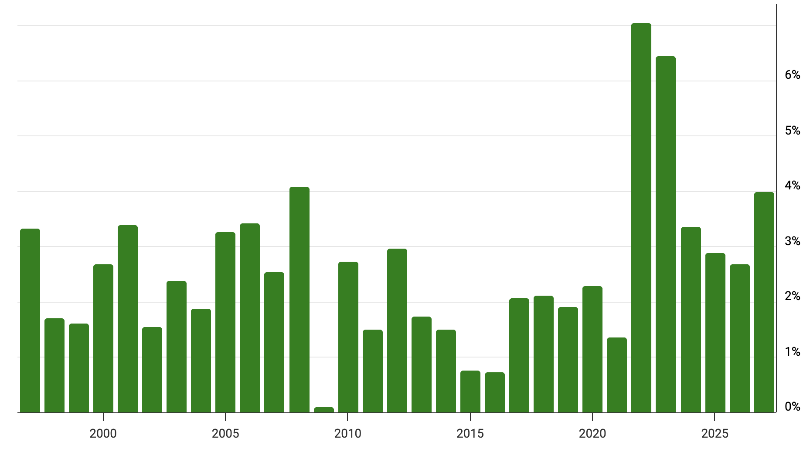

# Jeffrey Sherman

Jeffrey Sherman is the Deputy Chief Investment Officer of DoubleLine Capital, the firm founded by Jeffrey Gundlach.  He hosts The Sherman Show podcast and speaks frequently about rates, credit, and macro.

## Jeffrey Sherman on the Treasury Rally, Fiscal Fears and Fading Foreign Demand (October 19, 2026)

[Link](https://www.youtube.com/watch?v=Dn891oSS_Ns)

The Fed should be tighter than where they are today.

French yields hit their highest since 2002.

They are underweight the back end of the curve.  They think ultimately debt issues will be a problem.

Market is already priced for hikes over the next 3-6 months.

Political gridlock is good.  Not expanding the debt as fast is a good thing right now.

We need to find buyers for our bonds.  We need to be nice to our trading partners.

Global yields are converging, which is also lowering demand for US Treasuries.

Many central banks are moving towards gold instead of Treasuries.

## Jeffrey Sherman: Throw Away the Post-GFC Playbook | Insightful Investor Podcast

[Link](https://www.youtube.com/watch?v=SurdHgqqlmo)

We need to throw away the playbook in the post-GFC era (2010-2020).  This was the financial repression world, with global coordination of rate/trade policies.  The bond market was managed.  The central banks meddled in the bond markets.

This all changed during the pandemic.  The money supply increased globally and inflation also increased globally.

We are still awash with a lot of this money.

We now have a market that's more akin to the 2000-2007 market.  During this period, nominal growth was high and inflation was 3-4%.

We need to grow our way out of some of our debt issues.

The coordinated 2010-2020 era, aka the "fixed income dungeon," had 1.5-2% yields and didn't offer many opportunities for a bond investor.

The bond market is saying that rates should be higher.

The numbers make sense from a bond investor's perspective:

* high-quality front-of-the-curve yield is 5%
* belly of the curve is 5.5%
* more credit risk gives 6%

Even with inflation of 3%, we have some cushion.

You're in a good spot in the bond market right now.

If you have a bond portfolio with a yield of 5% and a duration of 2 years, you have a decent starting point, even if inflation is 3-4%.  You weren't able to build a portfolio that was a few hundred basis points over inflation.

They like short-term TIPS, but don't like intermediate TIPS.

Kevin Warsh keeps saying that he will get inflation down.  He's trying to establish credibility.

US manufacturing is booming in the form of data centers.

We saw an acceleration in gold prices last year based on central bank action.  It's a de-dollarization trade.

The deficit has been out of control and we will have to restructure.  This will happen when something breaks.

Our deficit is around $1.5-2 trillion.  It's huge.

Inflation is regressive.  The lowest cohort is impacted most.  Investors can buy an asset that returns inflation + a premium.

Asset owners have done well since 2020.  The lower cohort has not done well since 2020.

Regressive policies:

* money printing
* tariffs (cause short-term inflation)
* wars (more inflation)

Our spending is reckless.  Free stuff is super popular.

None of us can fathom what AI will be.

Some people have gotten really comfortable with cash and they should be considering stepping out the curve a little bit.  A high-quality, low-duration portfolio can pick up 150 bp over cash.

The S&P currently has a lot of concentration risk.  It's probably better to just buy tech and then something else alongside it to give yourself the proper mental accounting.

We are at all-time highs of concentration in the US now.  Other markets are also concentrated, maybe even more so.

There was also mega-cap dominance in the 90s.  We've seen this before, but not quite to this extent.

The S&P 500 is not like it was 10 years ago.  It's way more concentrated.

Factor investing has gone away.  The only factor that people care about now is momentum.

The hardest thing to do as a portfolio manager is to sell the winning trade.

We know the risks are building, but it's hard not to participate in them.

Participate, but be mindful of diversification, so you are not overexposed.

DoubleLine is negative on the dollar over the medium term.

Their EM fund has a 7.25% yield with a 4.5-5-year duration.  It's mainly investment grade.  They forecast a good currency translation and are being paid to wait.  This is a boring trade.
